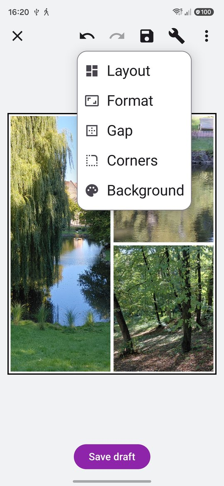
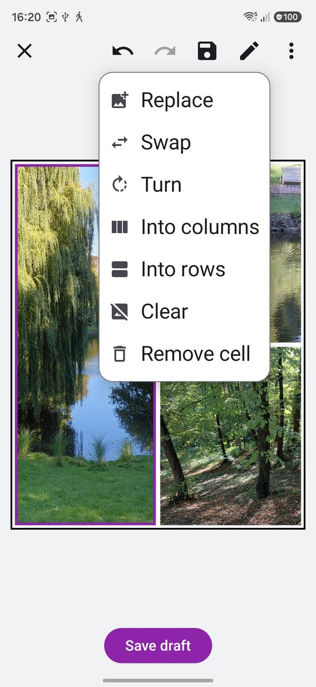
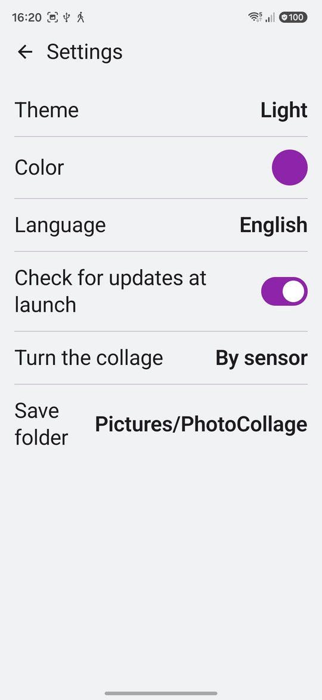

# PhotoCollage

**Photo collages on your phone: pick photos, pick a layout, move the borders,
save or share.**

| Collage | Cell | Settings |
|---|---|---|
|  |  |  |

## Features

- **Photos in**: from the system's picker — which lists every app that hands
  out images, PhotoBox among them — or shared to PhotoCollage from another app.
- **Layouts**: ready-made ones for 1 to 7 photos, turned and mirrored in the
  Layout dialog; any cell can be cut in two, across or down, or removed, up
  to 16 cells.
- **Borders**: drag a gap between cells to move it.
- **Photo in its cell**: drag to move it, pinch to zoom, turn two fingers to
  tilt it to any angle, turn it a quarter at a time — which also straightens a
  tilt — replace or clear it.
- **Swap**: long-press a photo and drop it on another cell, or select a cell,
  tap Swap and tap the other one.
- **Format**: portrait or landscape, the shape — 1:1, 4:5, 3:4, 2:3, 9:16 or
  A4 — and the size it is saved at; or a preset that sets all three at once:
  Instagram, Stories, HD, Full HD, 2K, 4K, a 10×15 print, A4.
- **Look**: the gap's width, rounded corners, and the background colour.
- **Tools**: layout, format, gap, corners and background under the wrench at
  the top; while a cell is selected the same button is a pencil and holds the
  cell's own tools.
- **Undo and redo** for every step.
- **Turning**: the collage turns with the phone by the sensor even with
  auto-rotate off, while the editor stays upright — or as the system says, or
  never (Settings).
- **Out**: save as a JPEG under a name of your own — the moment, unless
  changed — into `Pictures/PhotoCollage` or a folder picked in Settings; or
  share it.
- **Properties** (⋮): the way round, shape, size, preset, and how many cells
  and photos.
- **Kept**: the collage being edited is there again at the next start, even
  after the system closed the app; a new collage — from the menu or photos
  shared in — asks first, and can save the old one as the draft.
- **Draft**: save the collage by hand (under it, or ⋮) and open it again later; the app
  keeps its own copy of every photo in it.
- English, Russian and Ukrainian; light and dark themes with accent colours.

No permissions besides the updater's: photos come in through the picker or
Share, saving into Pictures needs none, and another folder is granted once
through the system's folder picker.

## Build

The numbered scripts build, install and release it; `AGENTS.md` says how they
fit together. `./00-MakeAll.sh` is the usual day.

## License

GPL v3, see [LICENSE](LICENSE).
